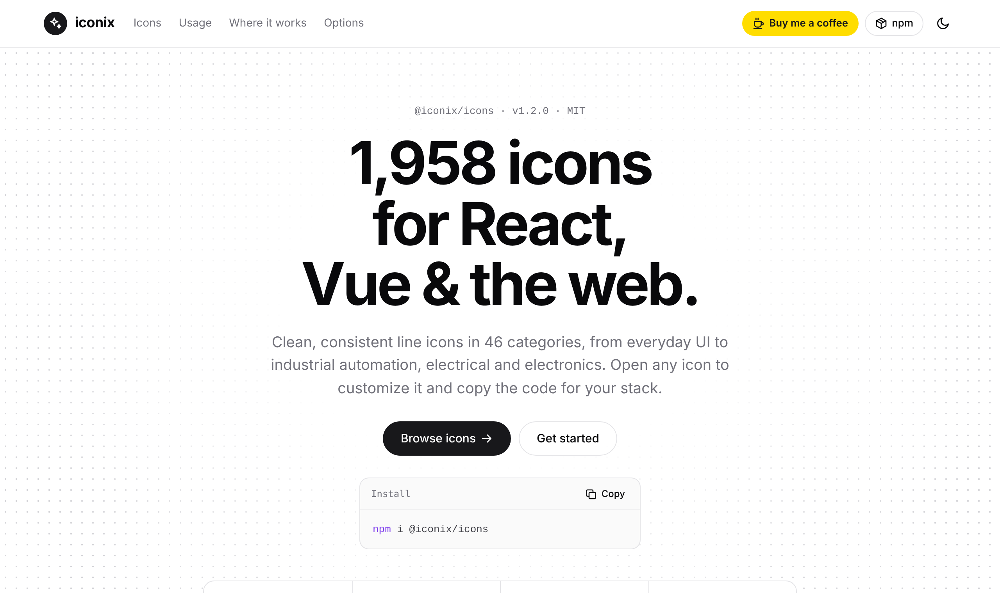
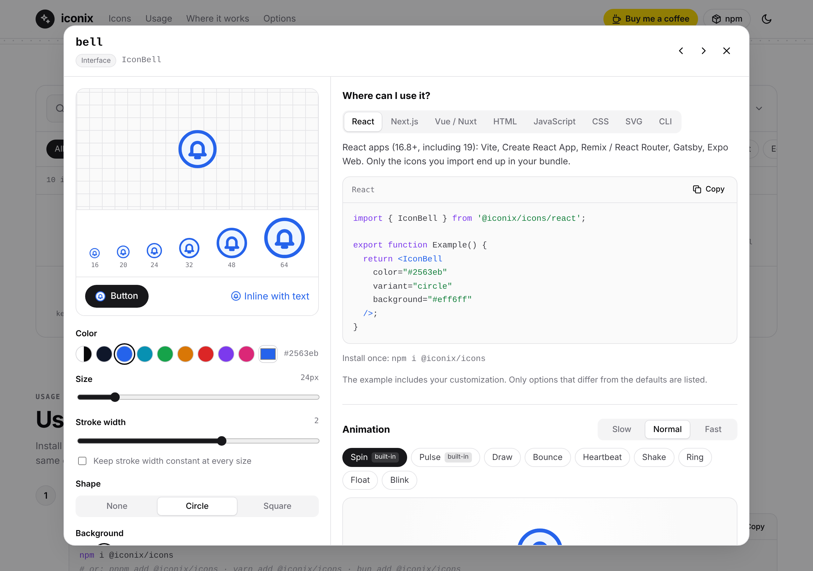
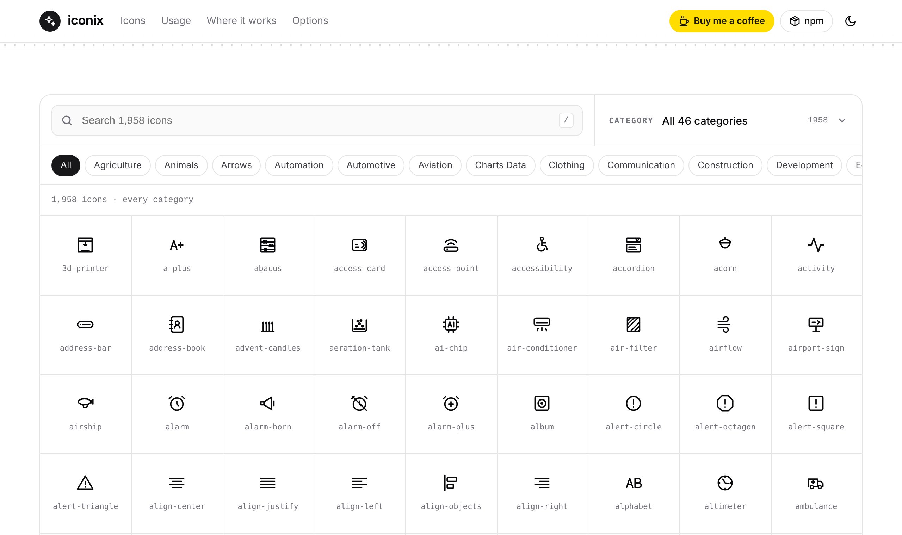

<div align="center">

<a href="https://bartek-figat.github.io/iconix-site/">
  <picture>
    <source media="(prefers-color-scheme: dark)" srcset="docs/logo-white.svg">
    
  </picture>
</a>

<h3>1,958 free SVG icons for React, Vue and the web</h3>

<p>
  <a href="https://bartek-figat.github.io/iconix-site/"></a>
  <a href="https://www.npmjs.com/package/@iconix/icons"></a>
  <a href="https://buymeacoffee.com/bartek1983d"></a>
</p>

<p><b><a href="https://bartek-figat.github.io/iconix-site/">bartek-figat.github.io/iconix-site</a></b></p>

</div>

<a href="https://bartek-figat.github.io/iconix-site/"></a>

## What you can do on the website

- **Browse every icon.** 1,958 icons in 46 categories, from everyday UI and web to industrial automation, electrical and electronics. Search by name or pick a category.
- **Customize before you copy.** Change the color, size, stroke width, shape (plain, circle or square), background, rotation and mirroring, and see the result live at every size.
- **Copy ready code.** Every icon has examples for React, Next.js, Vue / Nuxt, HTML, JavaScript, CSS, SVG and the CLI, updated with your settings.
- **Try animations.** Pick spin, pulse, draw, bounce, heartbeat, shake, ring, float or blink, press **Start** and copy the CSS.
- **Light and dark theme.** Light by default, one click to switch.

<a href="https://bartek-figat.github.io/iconix-site/"></a>

## Use the icons in your project

```bash
npm install @iconix/icons
```

**React / Next.js**

```tsx
import { IconBell } from '@iconix/icons/react';

<IconBell size={32} color="#2563eb" variant="circle" background="#eff6ff" />
```

**Vue**

```vue
<script setup>
import { IconBell } from '@iconix/icons/vue';
</script>

<template>
  <IconBell :size="32" color="#2563eb" />
</template>
```

**Plain HTML**

```html
<script type="module">
  import { defineIconElement } from 'https://cdn.jsdelivr.net/npm/@iconix/icons/dist/element.js';
  defineIconElement();
</script>

<iconix-icon name="bell" size="32" color="#2563eb"></iconix-icon>
```

Full documentation: [npmjs.com/package/@iconix/icons](https://www.npmjs.com/package/@iconix/icons)

<a href="https://bartek-figat.github.io/iconix-site/"></a>

## Support

Iconix is free and MIT licensed. If it saves you time, you can **[buy me a coffee](https://buymeacoffee.com/bartek1983d)**. Every coffee goes into new icons, fixes and updates.

## License

MIT © Bartek Figatowski
